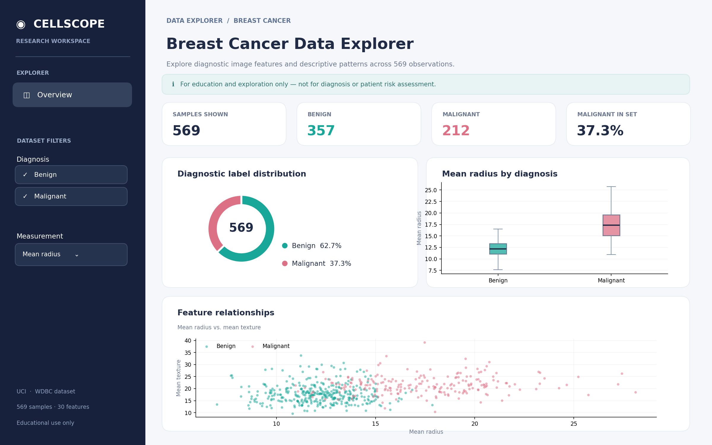

# CellScope | Breast Cancer Data Explorer



**A reproducible, interactive Python dashboard exploring diagnostic patterns in cell-image measurements from the Wisconsin Diagnostic Breast Cancer dataset.**

**Live demo:** Not deployed yet. The app can run locally or be deployed free on Streamlit Community Cloud.

## Why I built this

Healthcare datasets are easy to visualize but also easy to misinterpret. I built CellScope to practice data cleaning, descriptive analytics, interactive visualization, and transparent documentation. The dashboard compares **benign vs malignant labels in the dataset**, not individual patients' clinical outcomes.

## Features

- Filter samples by original diagnostic label.
- Explore a distribution donut, interactive box plots, and a scatter plot.
- Compare sample count, mean, median, and standard deviation across groups.
- Hover for observation-level image features and download filtered CSV data.
- Transparent source and limitations: no hidden predictive claims.

## Dataset and analysis

Source: [UCI Breast Cancer Wisconsin (Diagnostic)](https://archive.ics.uci.edu/dataset/17/breast+cancer+wisconsin+diagnostic), accessed via [`sklearn.datasets.load_breast_cancer`](https://scikit-learn.org/stable/modules/generated/sklearn.datasets.load_breast_cancer.html). The sample contains **569 breast-mass fine-needle aspirate image specimens** with **30 real-valued nuclear features**, labeled **357 benign** and **212 malignant**.

| Metric | Actual dataset result |
|---|---:|
| Total observations | 569 |
| Benign | 357 (62.7%) |
| Malignant | 212 (37.3%) |
| Missing feature values | 0 |

The feature distributions can differ by label; for example, mean radius is higher on average for malignant-labeled samples. This is an **association in this selected dataset**, not a causal relationship, validated clinical rule, or estimate of cancer prevalence.

**No simulated observations were used.** The screenshot in `screenshots/` is a *designed, static preview generated from the real dataset*, rather than a capture of a deployed Streamlit window. The live Streamlit app dynamically recalculates results when filters change.

## Screenshots


## Run locally

You need Python 3.10+ and an internet connection to install packages the first time. No API key or external dataset download is required.

```bash
# Mac / Linux
python3 -m venv .venv
source .venv/bin/activate
pip install -r requirements.txt
streamlit run app.py
```

Windows (PowerShell):

```powershell
py -m venv .venv
.venv\Scripts\Activate.ps1
pip install -r requirements.txt
streamlit run app.py
```

Then open the localhost link printed in Terminal, typically `http://localhost:8501`.

To run data-only tests:

```bash
python -m unittest discover -s tests -v
```

## Project structure

```text
medical-data-dashboard/
├── app.py                 # Streamlit dashboard
├── analysis.py            # Independently testable statistics/data loading
├── requirements.txt       # Python packages
├── README.md              # Description, results, setup
├── RESULTS.md             # Interpretation and limitations
├── GITHUB_GUIDE.md        # Upload and deployment walkthrough
├── data/
│   └── wdbc_features.csv  # Analysis-ready source copy
├── screenshots/
│   └── dashboard-overview.png  # Real-data static preview
└── tests/
    └── test_analysis.py
```

## Limitations and next steps

- Dataset is not representative of screening patients or the general public.
- These are **image-level features**, not demographics, dates, or longitudinal trends.
- No independent external validation, fairness analysis, or clinically validated diagnostic classifier is provided.
- Next: add documented data quality checks and more interpretable feature comparisons, then investigate robust model validation as a distinct research project.

**Disclaimer:** Educational exploration only. Not for medical diagnosis or treatment.

tly.
